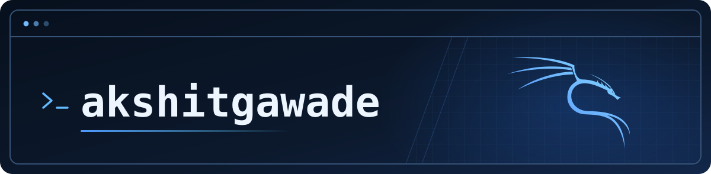
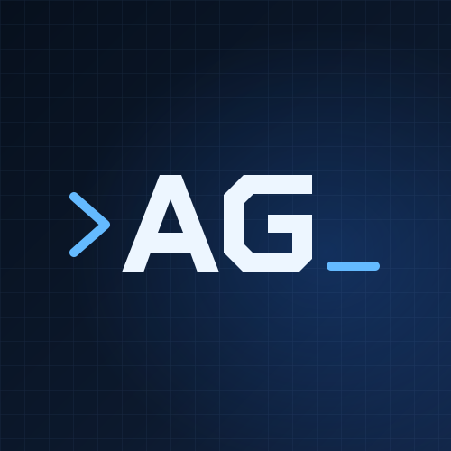
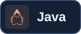

  

<h3 align="center">Software Development · Cybersecurity</h3>

## About Me

I’m a cybersecurity enthusiast and second-year Computer Science and Engineering student with a foundation in **C, C++, Java, and data structures**. My research internship and labs gave me hands-on exposure to **network analysis, web application testing, and Azure security fundamentals**.

I enjoy building practical applications and understanding the systems they depend on. I’m strengthening my Linux, networking, and problem-solving skills by tracing how software works and testing what I learn in labs.

 

## Projects

| Project | About | Stack | Repository |
| --- | --- | --- | --- |
| **Narrative Lens** | Compares how news outlets report on the same event. The analysis API ingests feeds and articles and measures source attribution, agency, and language intensity. The dashboard compares stakeholder coverage and shows how headlines changed between saved snapshots. | **Web** TypeScript, React/TanStack, Tailwind CSS  **Analysis** Python, FastAPI, NLP (spaCy, Groq)  **Data** Supabase (PostgreSQL) | [Source](https://github.com/akshitgawade/lens-media) |
| **EVSBS** | A modular web app for finding EV charging stations, checking availability, and reserving or cancelling slots. Express hosts separate modules for authentication, stations, bookings, and administration. MongoDB transactions group booking and simulated payment updates. | JavaScript, Node.js, Express, MongoDB Atlas. | [Source](https://github.com/akshitgawade/EVSBS) |

<!-- Add Praman to the project table once its description and public repository or demo link are ready. -->

## Experience

### Cyber Secured India (Safe Skills Limited)

**Research Intern** · September–November 2026

Studied and practiced these topics during the internship.

- Cyber Foundation (operating systems and network essentials), AI in cybersecurity, reconnaissance, and Burp Suite.
- Selected OPSWAT Associate certifications, then injection vulnerabilities, authentication, broken access control, SSTI, and CSRF.
- Nmap, Linux and Windows privilege escalation, Android and iOS penetration testing, dark web OSINT, and Azure cloud security.
- Digital forensics fundamentals and case studies.

## Education

### B.Tech in Computer Science and Engineering

**Symbiosis Institute of Technology, Pune** · 2025–2029

<h2 align="center">Skills &amp; Tools</h2>

<h3 align="center">Cybersecurity</h3>

  
  
  

<h3 align="center">Security Tools</h3>

  
  
  
  
  
  

<h3 align="center">Programming Languages</h3>

  
  
  
  
  

<h3 align="center">Computer Science</h3>

  
  
  
  
  
  
  

<h3 align="center">Networking</h3>

  
  
  
  
  

<h3 align="center">Databases</h3>

  
  
  

<h3 align="center">Web Development</h3>

  
  

<h3 align="center">DevOps &amp; Infrastructure</h3>

  
  
  
  
  

<h3 align="center">Software &amp; Hardware</h3>

  
  

<h2 align="center">Connect With Me</h2>

  
  
  

